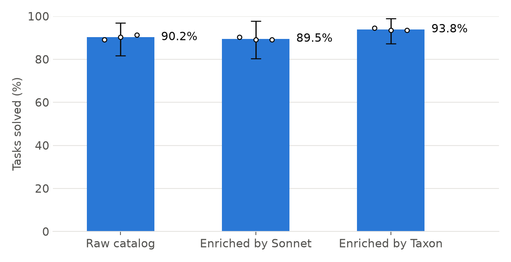
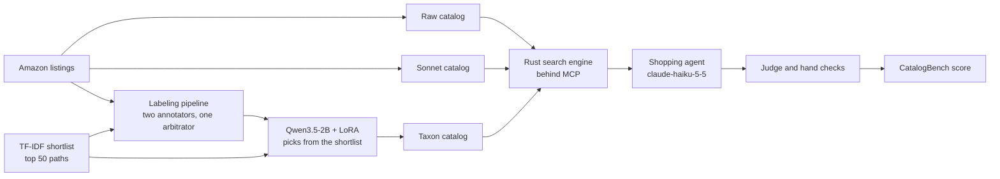

# Taxon

A small local model that files products into Shopify's taxonomy, and a benchmark that asks whether
shopping agents do better for it.

[](https://github.com/CarlGergi/Taxon/actions/workflows/ci.yml)      



*CatalogBench: share of 92 shopping tasks solved on each catalog over three rounds. Whiskers are
95% intervals over source products; dots are single rounds.*

## At a glance

| Measure | Result |
| --- | --- |
| Enriching the 2,000 products | Sonnet: $13.27 in API calls. Taxon: no API cost, 2.5 hours on one M5 Max |
| Tasks solved on Taxon's catalog | 93.8% [87.3, 98.9] |
| Tasks solved on the raw catalog | 90.2% [81.7, 97.0] |
| Tasks solved on Sonnet's catalog | 89.5% [80.4, 97.7] |
| Taxon minus raw | 3.6 points [-2.5, 11.8]: not resolved |
| Taxon minus Sonnet | 4.3 points [-2.4, 13.1]: not resolved |
| Exact category on 50 hand-labeled products | Taxon 48.0% [34.8, 61.5]; its training labels 52.0% [38.5, 65.2] |
| LLM judge against hand judgments | 95.6% [85.2, 98.8] agreement on 45 pairs |

Brackets are 95% intervals. With 92 tasks from 41 products and 50 hand-labeled products, a
difference of a few points does not resolve, and the README says so rather than ranking.

## Overview

Taxon fine-tunes Qwen3.5-2B, a vision-language model small enough to run on a laptop, to classify
products into Shopify's open product taxonomy and extract their attributes. Its training labels
come from two LLM annotators and an arbitrator, and it is checked against 50 products labeled by
hand. CatalogBench then gives the same shopping agent three versions of a 2,000-product catalog,
raw, enriched by `claude-sonnet-5-5` and enriched by Taxon, and measures how often it finds a
product that meets every requirement. Only the catalog changes between conditions.

## Architecture



| Component | Technology | Why |
| --- | --- | --- |
| Label space | Shopify's open product taxonomy, pinned release | Real merchants use it, and every path and attribute value can be checked |
| Shortlist | TF-IDF and logistic regression (scikit-learn) | Cheap and local; it narrows 64,292 paths to 50 candidates |
| Training labels | `claude-haiku-5-5` and `gpt-6-luna` annotators, `claude-sonnet-5-5` arbitrator | Two vendors err differently; the arbitrator is paid only on disagreement |
| Model | Qwen3.5-2B with LoRA (PyTorch, Transformers, PEFT) | Small enough to fine-tune and run on one laptop |
| Decoding | Token trie over taxonomy paths | Every answer is a real path or "none" |
| Reinforcement learning | GRPO (TRL) | Rewards computed from the taxonomy, with no reward model; built and tested, see Limitations |
| Search | Rust and tantivy, served over MCP | One tool schema for every catalog, so the data is the only difference |
| Agent | `claude-haiku-5-5` | Cheap enough for three rounds of every task on every catalog |
| Judge | `gpt-6-luna` | Not Claude, so it cannot share the arbitrator's or the agent's leanings |

## Quick start

You need [uv](https://docs.astral.sh/uv/) and [rustup](https://rustup.rs). Every input is pinned to
an exact version and checksum.

```bash
make setup
make test
make reproduce
```

`make test` runs offline. `make reproduce` downloads about 115 MB, runs every test, and rebuilds
every number here into `results/` in a few minutes on a CPU, without calling a paid API. Numbers
that came from paid model calls or GPU runs are rebuilt from the outputs saved under `data/`,
which stay out of git apart from the 50 hand labels; without them, it says which steps it skipped.
How each part works, with its commands and the detailed results, is in
[docs/DETAILS.md](docs/DETAILS.md).

## Results

### CatalogBench

**Taxon's catalog costs nothing in API calls, and no agent measure tells it apart from Sonnet's.**
Enriching the 2,000 products cost $13.27 in API calls with `claude-sonnet-5-5` and nothing with
Taxon, which ran locally for 2.5 hours on one M5 Max. On tasks solved, the interval rules out
Taxon's catalog being more than 2.4 points worse than Sonnet's.

**The benchmark is at its ceiling.** The raw catalog already solves 90.2% of tasks, so neither
enriched catalog is resolved as better than raw: Taxon's is 3.6 points [-2.5, 11.8] ahead.

92 hand-checked tasks from 41 hand-labeled products, each run three times on each catalog by
`claude-haiku-5-5`. A task is solved when the first product returned meets every requirement.
Intervals resample source products. Differences are paired by task, in percentage points for the
first three rows.

| Measure | Raw | Sonnet | Taxon | Taxon minus raw | Taxon minus Sonnet |
| --- | --- | --- | --- | --- | --- |
| Tasks solved | 90.2% [81.7, 97.0] | 89.5% [80.4, 97.7] | 93.8% [87.3, 98.9] | 3.6 [-2.5, 11.8] | 4.3 [-2.4, 13.1] |
| Precision | 95.9% [92.5, 98.3] | 98.2% [96.4, 99.6] | 97.3% [95.0, 99.1] | 0.3 [-1.7, 2.0] | -0.6 [-2.1, 0.4] |
| "No product matches" answers | 8.7% [2.8, 16.7] | 9.8% [2.2, 18.7] | 6.2% [1.1, 12.7] | -2.5 [-11.1, 4.4] | -3.6 [-11.8, 2.6] |
| Searches per task | 2.66 [2.43, 2.88] | 2.60 [2.37, 2.83] | 2.59 [2.38, 2.79] | -0.07 [-0.24, 0.09] | -0.01 [-0.17, 0.14] |
| Model calls per task | 2.54 [2.44, 2.63] | 2.59 [2.48, 2.69] | 2.57 [2.46, 2.68] | 0.03 [-0.06, 0.13] | -0.02 [-0.10, 0.07] |
| Tokens per task | 36,153 [31,572, 41,111] | 37,186 [31,998, 42,415] | 38,514 [34,236, 43,110] | 2,361 [-1,559, 6,067] | 1,328 [-1,747, 4,445] |
| Agent cost per 1,000 tasks | $2.95 [2.59, 3.33] | $2.78 [2.39, 3.19] | $2.92 [2.58, 3.29] | -0.03 [-0.35, 0.28] | 0.14 [-0.10, 0.38] |
| Enriching the 2,000 products | none | $13.27 in API calls | no API cost; 2.5 hours on one M5 Max | | |

- The one invented product ID came from a raw-catalog run, third of the ten products it returned;
  it counts as wrong.
- Taxon's catalog gave no category to 112 of the 2,000 products: its model answered "none" from
  its shortlist. They stay in the catalog as raw listings, so keyword search still finds them but
  a category or attribute filter never returns them. They include every gold product of 3 tasks.

#### Exploratory: does the title already name what the task asks for?

This split comes from task metadata alone, fixed before looking at any result by group: a task
counts as named when the title of the product it was drafted from names its required category or
one of its required attribute values. It was not planned before the runs, and no difference in it
resolves.

| Tasks | Count | Raw | Sonnet | Taxon | Taxon minus raw | Taxon minus Sonnet |
| --- | --- | --- | --- | --- | --- | --- |
| Title names a requirement | 41 | 95.9% [89.7, 100.0] | 97.6% [91.9, 100.0] | 99.2% [97.5, 100.0] | 3.3 [-0.9, 9.5] | 1.6 [-2.2, 7.5] |
| Title names none | 51 | 85.6% [75.0, 94.9] | 83.0% [69.8, 95.7] | 89.5% [78.8, 99.3] | 3.9 [-3.8, 14.3] | 6.5 [-3.8, 18.5] |

Tasks whose requirements the title does not name are harder on every catalog, and Taxon's catalog
gains about as much on both.

### The judge

Returned products outside a task's hand labels were checked by `gpt-6-luna`, used only once it
agreed with hand judgments on a seeded sample: at least 90%, on at least 45 pairs it answered. It
was unsure of 6 of the first 50 pairs, one more than that allows, so the sample grew to 51 in the
same seeded order. It agreed on 43 of the 45 it answered, **95.6% [85.2, 98.8]** (95.5% on the
first 50), with Cohen's kappa **0.81 [0.46, 1.00]**. Both disagreements were lenient, accepting a
product the hand judgment rejected, and both were on products all three catalogs returned. The 31
of 238 pooled pairs it was unsure of were judged by hand.

### Category accuracy on the hand labels

| Model | Exact category | Top level | Minus its training labels |
| --- | --- | --- | --- |
| Training labels (two annotators and an arbitrator) | 52.0% [38.5, 65.2] | 94.0% [83.8, 97.9] | |
| Fine-tuned to write the path, constrained to real paths | 20.0% [11.2, 33.0] | 90.0% [78.6, 95.7] | -32.0 [-50.0, -14.0] |
| Fine-tuned to pick from a 50-path shortlist (Taxon) | 48.0% [34.8, 61.5] | 88.0% [76.2, 94.4] | -4.0 [-14.0, 6.0] |

Picking from a shortlist matches the training labels with one local model call, where the labels
took two paid annotators and an arbitrator; writing a path from all 64,292 categories does not.
**The shortlist caps it at 76%**: the exact hand label is among the 50 candidates for 38 of the 50
products.

### How the hand labels were made

The 50 hand-labeled products are drawn before any training from a held-out pool, and cover all 28
product domains. They were labeled on a local page that shows the listing, a search over every
category path and a keyword baseline's top 5 guesses, but never the annotators' answers.


*The labeling page on a real product from the pool, with a category search under way.*

## Limitations

- **Unsupported attributes steer the agent.** Taxon's catalog tags Sunflower Botanicals Wormseed
  Extract as made in the United States, though its listing never says where it is made. On two
  "made in the United States" tasks the agent found it through that tag and returned it in 4 runs;
  by hand it fails both. It was never returned first, so it lowers precision, not task success.
  How often each catalog states more than its listings:

  | Check | Taxon | Sonnet |
  | --- | --- | --- |
  | Specific countries of origin that the listing text never names | 18 of 32, 56.2% [39.3, 71.8] | 4 of 9, 44.4% [18.9, 73.3] |
  | Values on verified products where the hand label is blank | 191 of 244, 78.3% [71.9, 83.5] | 120 of 168, 71.4% [64.1, 77.8] |
  | Values on verified products that contradict the hand label | 9 of 53, 17.0% [9.2, 29.2] | 9 of 48, 18.8% [10.2, 31.9] |
  | Values that are the catch-all "Other" | 3,908 of 14,733, 26.5% | 133 of 7,300, 1.8% |

  The hand-label rows are upper bounds, since attributes on the labeling page were optional.
  Details: [docs/DETAILS.md](docs/DETAILS.md#unsupported-attribute-values).
- **The benchmark is near its ceiling.** The raw catalog already solves 90% of tasks, and with 92
  tasks the difference between Taxon's catalog and the raw one spans -2.5 to 11.8 points.
- **Small hand-labeled sets.** 50 products give intervals of about 13 points either side at 70%
  accuracy. 8 of the 100 drafted tasks were left unchecked and never run.
- **GRPO and quantization were not run on the final model.** Both are built and tested; the short
  GRPO run stopped before its first checkpoint when it competed for the GPU, and FP8 needs an
  NVIDIA GPU.

## How it's tested

`make reproduce` runs 911 Python tests, 41 of them on the real data and results, and 30 Rust
tests of the search engine. Paid APIs are replaced by fakes in tests, and the real-data tests check
that every number in this README and in [docs/DETAILS.md](docs/DETAILS.md) matches `results/`.
CI runs the lint and the other 870 Python tests and the Rust tests on every push, on Ubuntu, with
no keys. Tests cannot reach the network unless they are marked as needing real data, and those
stay out of CI.

## License

The code is under the MIT license: see [LICENSE](LICENSE). Amazon Reviews 2023 comes from the
McAuley Lab and keeps its own terms. Qwen3.5-2B and Qwen3.5-4B are under Apache-2.0.
